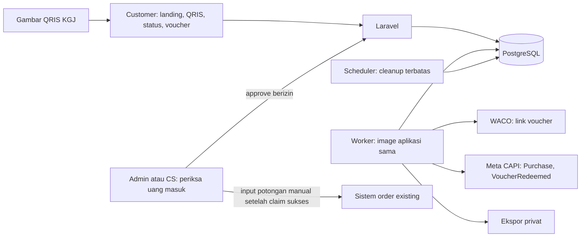

# Architecture System — Voucher Digital Sat-Set

Versi 0.3 · 14 Oktober 2026 · QRIS gambar merchant + approval manual + Meta tracking ditetapkan pengguna.

Acuan kebijakan: [PRD](PRD.md), [stack](TECH-STACK.md), [desain](../DESIGN.md). Domain/hosting pengguna; Docker wajib. Aplikasi hanya menangani funnel/voucher; order cincin/DP existing **tanpa integrasi**.

## 1. Bentuk sistem

Satu Laravel modular monolith dengan area publik dan satu Admin untuk admin/CS berakun bernama. QRIS ditampilkan dari gambar asli KGJ. Admin memverifikasi transaksi merchant; aplikasi menerima keputusan terautentikasi dan menjaga konsistensi, tidak mengklaim membaca bank otomatis.

Panah ke order adalah tindakan manusia, bukan koneksi API aplikasi. Docker Compose: app PHP 8.4/Apache, worker/scheduler image sama, PostgreSQL 17 volume persisten. Healthcheck DB, migrasi sekali, secrets runtime dan ingress/HTTPS pengguna. [Compose](https://docs.docker.com/compose/intro/compose-application-model/), [readiness](https://docs.docker.com/compose/how-tos/startup-order/). Belum ada code/container/config Docker yang dibuat.

## 2. Module dan interface

| Module | Interface konseptual | Invariant/implementation yang disembunyikan |
|---|---|---|
| Payment | createCheckout(data), confirmPaidByCustomer(orderAccess), approve(command, admin, requestKey) | Snapshot QRIS/policy; customer hanya meminta review; approve uang terverifikasi, referensi unik, voucher/jobs atomik |
| Voucher | view(token), transfer(command, admin) | Umur dari paid_at, pemilik, sekali transfer, revoke token/kode dan WA |
| Redemption | preview(voucherRef), claim(command, admin, requestKey) | Status/tier/quote/order uniqueness, kelayakan manual, lock/mutasi/audit/event sekali |
| Meta delivery | sendEvent(resource, eventType) | Payload customer/consent, event_id/time stabil, status/retry dan nonblocking business operation |

Ini seam untuk caller dan test, bukan kewajiban membuat generic class/repository. Payment.approve memberi Depth dengan menyembunyikan idempotensi, waktu, duplikasi penerimaan, penerbitan dan job di belakang satu interface. QR/input manual menggunakan interface Redemption sama. Dependency clock/HTTP WACO/Meta dapat diganti untuk test; pakai fitur Laravel/HTTP fake tanpa provider gateway generik.

## 3. Data minimum

| Data | Isi/invariant |
|---|---|
| payment_orders | Harga/IDR, status, snapshot policy/qr_image_version/receiver_key, buyer/consent/context campaign, public_access_hash, customer confirmation, merchant_transaction_ref, paid_at, verified_at/by, requestKey/digest, Purchase event_id/delivery state |
| vouchers | Unique(payment_order_id), code/token_hash unik, token encrypted untuk kirim WA, pemilik/WA, purchased_at sama paid_at, policy_id, lifecycle/revision |
| redemptions | Unique(voucher_id), unique(branch_id,normalized_order_ref), actor/requestKey/digest, confirmed_at WIB, umur, potongan, kelayakan manual, event_id/delivery state |
| transfers | Unique(voucher_id); old/new owner, consent check, actor/waktu; satu transfer berhasil |
| voucher_policies | Versi immutable harga/minimum transaksi/empat tier; tidak menyimpan aturan DP |
| users / branches | Akun Admin aktif/bernama; cabang aktif/profil resmi |
| settings / asset | Gambar QRIS versi asli, receiver_key/label merchant, kontak bantuan; tidak menyimpan credential CAPI di aset publik |
| audit_log | Aksi/actor/resource/waktu/detail minimum; append-only, tanpa raw token/secret/PII berlebihan |
| jobs / failed_jobs | Queue Laravel database; payload ID minimum, resource/revision/event_id, tanpa custom broker/outbox kedua |

Unique(receiver_key,merchant_transaction_ref) pada pembayaran yang diverifikasi mencegah satu penerimaan dipakai dua checkout; pending boleh belum memiliki ref. Referensi merchant disimpan sesuai sumber (trim tanpa mengubah format/case yang belum diketahui). receiver_key mengikuti snapshot checkout agar pergantian QRIS tidak menghapus riwayat tujuan.

Timestamps disimpan berzona; paid_at adalah waktu pembayaran merchant, verified_at adalah approval admin. Waktu bayar harus sah/tidak di masa depan/sesudah verified_at. Purchased_at/aturan tidak digeser karena approval/retry/pergantian QRIS. Uang integer rupiah. [PostgreSQL date/time](https://www.postgresql.org/docs/17/datatype-datetime.html)

Asset QRIS asli PNG/JPEG divalidasi konten/size, nama aman, tidak executable/SVG atau fetch URL arbitrary. Versi lama tetap tersedia bagi checkout yang mengacu padanya sampai sesuai retensi. Halaman status pesanan akses token acak/session checkout; QRIS merchant dapat publik, token/status/PII customer privat. Token voucher ≥128-bit, hash lookup, encryption kirim ulang, tidak masuk log/analytics.

## 4. Transaksi approval QRIS

1. Checkout mengikat buyer, consent/context, policy, nominal Rp100.000, receiver dan gambar QRIS. Menekan Saya sudah bayar hanya mengubah pending review.
2. Admin memeriksa uang diterima, cocokkan customer/pesanan/nominal pada riwayat merchant. Reference customer bukan proof. Admin mengisi merchant_transaction_ref dan paid_at dari transaksi itu.
3. Server memeriksa session Admin aktif, input/ref/tanggal, expected order state, request key/digest, kemudian lock payment_order.
4. PAID dengan command identik → hasil sebelumnya; retry dengan key sama/payload berbeda → konflik. Customer/admin browser tidak memilih sendiri nilai paid yang dipercaya tanpa proses approve.
5. Dalam satu transaksi: simpan penerimaan/ref unik, PAID/verified_at/by/paid_at, voucher/policy/token, audit, job WA dan Purchase sesuai consent. Jika ref sudah dipakai order lain, rollback dengan alasan jelas.
6. Jobs menggunakan koneksi PostgreSQL yang sama dan insert sebelum commit; konfigurasi after_commit tidak dipakai untuk jalur atomik ini. Uji bahwa rollback membatalkan voucher/job dan crash setelah commit meninggalkan job durable.
7. Commit lalu balas hasil. Worker baru melakukan I/O WA/Meta; kegagalan tidak membatalkan uang/voucher. Approval ulang tidak menerbitkan resource/event baru. [Laravel database queue](https://laravel.com/framework/docs/13.x/queues)

Tanpa API merchant, keaslian penerimaan bergantung pemeriksaan operator. Server memvalidasi akses/invariant/duplikasi, bukan membuktikan sendiri uang masuk dari foto. Status PERLU_PERBAIKAN dan konfirmasi ulang hanya untuk order belum PAID, alasan/audit tersimpan.

## 5. Klaim dan transfer

Order/DP dikonfirmasi CS pada sistem existing; CS menggunakan panel voucher dalam alur pelayanan yang sama. Minimum belanja/promo diperiksa manusia pada order. Tidak ada field wajib nominal DP, bruto/net order, kuitansi DP, API order atau ledger cincin.

Preview menunjukkan potongan tanpa mutasi. Claim berisi cabang aktif, nomor order trim/uppercase, konfirmasi syarat/order-DP, expected quote dan requestKey. Actor dari session.

Transaksi claim:
- Lock voucher; periksa status AKTIF/belum expired, policy checkout, umur calendar WIB hari ini, syarat terkonfirmasi dan order/cabang.
- Request key terikat actor/action/digest; retry sama mengembalikan hasil sebelumnya, key sama dengan command berbeda ditolak.
- Quote berubah sejak preview → QUOTE_CHANGED tanpa mutasi, minta konfirmasi lagi.
- Simpan redemption, TERPAKAI, audit dan job VoucherRedeemed bila consent/matching sah; unique voucher dan branch/order menjadi pengaman akhir.
- Commit, tampilkan potongan yang terkunci; CS memfinalisasi input di order existing. Response hilang → cek request sebelumnya, bukan klaim baru.

Transfer memakai lock voucher yang sama: aktif/tidak expired/transfer0 dan persetujuan pemilik diverifikasi; update pemilik, rotate token **dan kode**, simpan transfer/audit/jobWA. Umur/policy tetap. Job WA mengecek revision aktif supaya tidak mengirim token lama. Race transfer/claim ditangani satu urutan lock, tidak ada transfer setelah claim. [PostgreSQL locks](https://www.postgresql.org/docs/17/explicit-locking.html), [constraints](https://www.postgresql.org/docs/17/ddl-constraints.html)

Tidak ada transaksi DB bersama dengan order lama. Claim berhasil tetapi input order gagal → operator melanjutkan order yang sama dengan ref claim, voucher tidak otomatis aktif kembali. Order batal tetap ditangani di order existing; riwayat voucher terpakai tidak dihapus/backdate.

## 6. Tracking Meta dan retry

Simpan context customer yang diizinkan pada checkout: campaign/UTM, klik/browser Meta yang nyata, URL asal aman, user-agent dan matching data sesuai API/consent. Jangan mengambil context browser admin saat approve. Pixel ViewContent/InitiateCheckout; CAPI Purchase server-only baseline setelah approval, value numeric 100000, currency IDR, event_time paid_at, event_id stabil.

Meta delivery state PENDING/SENT/FAILED/SKIPPED per business event. Perubahan consent tidak dipalsukan. Retry/error mempertahankan ID/time; setelah acknowledge tidak dikirim ulang sebagai event baru. Worker restart/double execution diuji. Jangan menjanjikan tepat sekali di API eksternal; jaga idempotensi lokal dan dedup sesuai versi Meta.

VoucherRedeemed terpisah dari Purchase. event_time waktu claim, action_source asal klaim cabang; tanpa nilai revenue cincin/potongan sebagai penjualan. Jika transfer, matching harus mewakili pemilik/consent aktual dan tidak menggabungkan cookies pembeli lama dengan identitas penerima. Internal reporting tetap menghubungkan voucher ke checkout/campaign awal, dengan riwayat transfer jelas.

Data customer dinormalisasi/hash menurut Meta; token order/voucher dan access token CAPI tidak masuk event_source_url/analytics/log. Versi API, dedup window dan freshness divalidasi saat implementasi/Test Events. Reject waktu event lama dicatat untuk tindak lanjut; jangan mengganti dengan timestamp fiktif. [SDK resmi server event](https://github.com/facebook/facebook-nodejs-business-sdk#conversions-api), [parameter builder PHP](https://github.com/facebook/capi-param-builder/blob/main/php/README.md)

## 7. Route dan keamanan

| Route konseptual | Akses/perilaku |
|---|---|
| /, /checkout | Publik/form/consent; harga server dan rate limit |
| /checkout/{orderAccess}/payment, /status | Bukti akses acak/session; QRIS/nominal/status minimum, private,no-store |
| /checkout/{orderAccess}/confirm | Bukti akses + CSRF; hanya pending review, tidak mengubah PAID |
| /v/{token} | Bearer voucher; noindex/private/no-store/no-referrer; tanpa Pixel |
| /admin/login, /logout | Session/CSRF/rate limit |
| /admin/orders, /orders/{id}/approve, /request-correction | Admin aktif; verifikasi manual/approve atomik/alasan |
| /admin/vouchers/preview, /redemptions | Admin aktif; scan/input/claim |
| /admin/vouchers/{id}/transfer, /resend | Admin aktif; aturan transfer dan WA aktif |
| /admin/settings/qris, /admin/exports | Admin aktif; asset QRIS versioned/ekspor privat |

Tidak ada endpoint payment gateway, webhook bank, callback browser paid atau koneksi order. WACO delivery callback hanya bila kontrak nyata menyediakannya. Session 2 jam idle, semua operator akses sama; tidak ada registrasi publik. HTTPS ingress/secrets/APP_KEY Docker dari hosting pengguna. Redaksi URL/token/PII, upload non-executable, data privat dan audit tetap guardrail.

## 8. Performa dan handoff

AGENTS: cache/invalidation QRIS versi/aset/cabang publik; status/admin/voucher/CSV private,no-store; pagination/proyeksi kolom, hindari N+1, indeks (status,created_at,id), paid_at, branch/confirmed_at dan unique lookup; scanner/code split/lazy, gambar ukuran tepat dan QR lossless; request dedup; memoization sesuai profiling; WA/Meta/CSV background. Scheduler hanya cleanup/pekerjaan terbatas, bukan approve bank otomatis.

Backup/restore melalui hosting pengguna; container app/worker/scheduler image sama, db volume persisten. Belum ada aplikasi/migrasi/Dockerfile/Compose/test/live integration. Test wajib mengikuti PRD: duplicate receiving ref, concurrent approve/claim/transfer, rollback jobs, paid_at versus verified_at, policy/tier WIB, consent/original-customer Meta, upload/PII/CSV, retries dan Docker health/volume/restore.

## Implementasi lokal aktual

Routes/controllers customer memegang akses bearer pesanan/voucher; asset QRIS dilayani stateless tanpa middleware session agar request gambar tidak mengubah tujuan redirect form. Semua aksi sukses memakai route tujuan eksplisit. Admin dilindungi auth dan pengecekan active pada database setiap request, termasuk persistent middleware Livewire.

`app/Services/VoucherActions.php` memegang approval, claim dan transfer atomik bersama audit/queue. Model menyimpan PII/token secara terenkripsi dan lookup hash; policy/gambar lama tidak diubah saat pengaturan baru disimpan. Unique constraint payment_order_id/voucher_id, receiver+merchant_ref, branch+order_ref dan request_key menjaga invariants bersama row lock.

`deliveries` adalah ledger terbatas untuk pengiriman Meta/WhatsApp, dengan event_id, revision, payload terenkripsi dan status; bukan event broker baru. `DeliverMessage` memakai HTTP client Laravel untuk CAPI dan WACO. WA memerlukan template tiga variabel body, sender eksplisit, credentials dan URL HTTPS; tanpa konfigurasi job SKIPPED. Marker SENDING di-commit sebelum I/O, lalu worker mengunci voucher→delivery untuk memeriksa revision/data pemilik dan menjaga token selama pengiriman. Crash/respons tidak pasti menjadi UNCERTAIN dan tidak di-POST ulang otomatis. HTTP429 kembali PENDING dengan release/backoff; penolakan yang jelas FAILED; HTTP200 dengan status terkirim SENT, tanpa klaim delivered/read. Tidak ada jaminan idempotency outgoing pada kontrak WACO. Kirim ulang oleh admin memerlukan konfirmasi pemeriksaan riwayat, request key unik dan tidak boleh tumpang tindih antrean revision yang sama. Reference pesan opsional disimpan terenkripsi dalam payload WA. Tidak ada endpoint webhook pada scope pengiriman dasar. `BuildExport` menggunakan chunk dan file privat; `voucher:prune` menahan kasus bantuan terbuka dan menghapus PII/token lama ketika eligible. [Kontrak WACO](research/WACO-API.md).

App/worker/scheduler memakai satu image dan volume storage; PostgreSQL volume terpisah, tanpa port database publik. Profile test/QA menggunakan database ephemeral terpisah. Implementasi dan pemeriksaan tidak mencakup sistem order existing, domain/hosting pengguna, atau kiriman eksternal nyata. Lihat [handoff](IMPLEMENTATION-HANDOFF.md).
